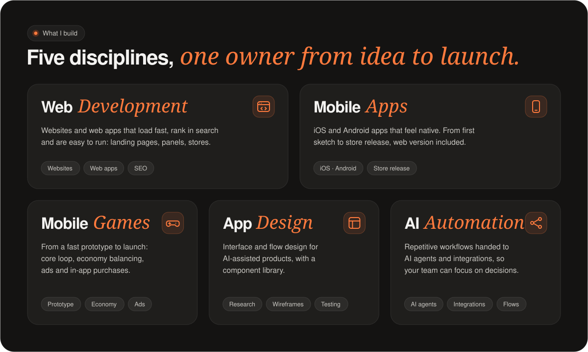
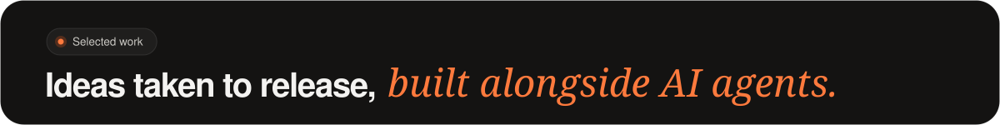

  
  
  

  I'm Emrah Atalay. I run a team of AI agents: code gets written, tested and reviewed, 
  and <b>every line passes human approval before it ships</b>. Web and mobile apps, games and automation, from idea to launch.

 

  

  

  
  

 

  

Türkçe için → <a href="https://eatalay.dev">eatalay.dev</a>

